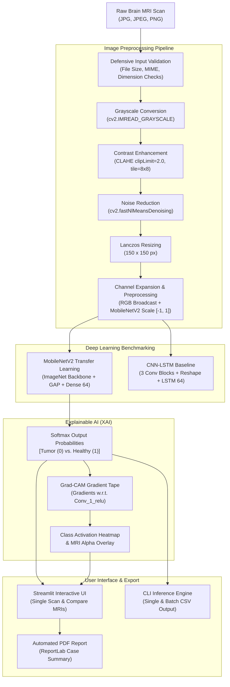

<div align="center">

# 🧠 NeuroScan AI
### Deep Learning-Based Brain Tumor Detection & Clinical Explainability from MRI Scans

[](https://www.python.org/)
[](https://tensorflow.org)
[](https://streamlit.io)
[](LICENSE)
[](https://github.com/ershivamkumar/NeuroScan-AI-Brain-Tumor-Detection/stargazers)
[](https://colab.research.google.com/github/ershivamkumar/NeuroScan-AI-Brain-Tumor-Detection/blob/main/Brain_Tumor_Detection_CNN_LSTM.ipynb)

<p align="center">
  <b>A comprehensive deep learning framework benchmarking Transfer Learning (MobileNetV2) against Hybrid CNN-LSTM architectures on MRI scans, complete with Grad-CAM visual interpretability, automated PDF diagnostic report generation, and an interactive Streamlit clinical research dashboard.</b>
</p>

</div>

---

## 📋 Table of Contents

1. [Project Overview](#1-project-overview)
2. [About NeuroScan AI](#2-about-neuroscan-ai)
3. [Problem Statement](#3-problem-statement)
4. [Project Objectives](#4-project-objectives)
5. [Key Features](#5-key-features)
6. [Technology Stack](#6-technology-stack)
7. [Project Architecture](#7-project-architecture)
8. [Dataset Information & Attribution](#8-dataset-information--attribution)
9. [Image Preprocessing Pipeline](#9-image-preprocessing-pipeline)
10. [CNN-LSTM Baseline Model](#10-cnn-lstm-baseline-model)
11. [MobileNetV2 Transfer Learning Model](#11-mobilenetv2-transfer-learning-model)
12. [Model Evaluation & Benchmark Results](#12-model-evaluation--benchmark-results)
13. [Grad-CAM Explainability](#13-grad-cam-explainability)
14. [Streamlit Web Application](#14-streamlit-web-application)
15. [Project Directory Structure](#15-project-directory-structure)
16. [Installation Instructions](#16-installation-instructions)
17. [How to Run the Application](#17-how-to-run-the-application)
18. [Screenshots & Visualizations](#18-screenshots--visualizations)
19. [Limitations](#19-limitations)
20. [Future Scope](#20-future-scope)
21. [Contributors & Acknowledgements](#21-contributors--acknowledgements)
22. [References & License](#22-references--license)

---

## 1. Project Overview

**NeuroScan AI** is an artificial intelligence-driven neuroimaging research prototype designed to assist researchers, clinicians, and machine learning engineers in detecting intracranial brain tumors from axial Magnetic Resonance Imaging (MRI) scans. 

The project evaluates both a custom **Hybrid CNN-LSTM** model and an **ImageNet-pretrained MobileNetV2** transfer learning model across 3,000 balanced MRI images from the Br35H benchmark dataset. The fine-tuned MobileNetV2 model delivers state-of-the-art diagnostic classification with **94.44% Test Accuracy** and **98.57% ROC-AUC**, substantially outperforming the baseline CNN-LSTM architecture (+43.55 percentage point gain).

To bridge the gap between black-box deep neural networks and clinical research utility, NeuroScan AI incorporates **Gradient-weighted Class Activation Mapping (Grad-CAM)** to visually highlight the exact anatomical regions governing inference, coupled with **ReportLab-powered automated clinical PDF report exports** and a dual-mode **Streamlit dashboard**.

---

## 2. About NeuroScan AI

NeuroScan AI was built to demonstrate an end-to-end, production-grade deep learning workflow:
- **Data Engineering**: Artifact removal, Contrast Limited Adaptive Histogram Equalization (CLAHE), and Non-Local Means Denoising.
- **Empirical Benchmarking**: Controlled architectural comparison between spatial sequence modeling (CNN-LSTM) and deep inverted residual networks (MobileNetV2).
- **Explainable Artificial Intelligence (XAI)**: High-resolution class activation heatmaps providing transparent anatomical justification.
- **Accessible Deployment**: Full-featured web dashboard and lightweight programmatic CLI for single-image and batch processing.

> [!IMPORTANT]
> **Medical Research Disclaimer:** NeuroScan AI is developed strictly for educational, scientific research, and architectural evaluation purposes. It is not an FDA-cleared or CE-marked medical device and must never be used as a primary diagnostic tool or clinical decision support system. Model scores represent algorithmic outputs and should always be validated by licensed medical professionals.

---

## 3. Problem Statement

Primary and secondary intracranial neoplasms are among the most aggressive oncological disorders worldwide. Early and accurate detection of brain tumors is vital for effective surgical planning, radiotherapy, and targeted chemotherapy. 

In clinical practice:
- **Diagnostic Burden**: Neuroradiologists inspect hundreds of slices per MRI study; high patient volume can induce cognitive fatigue and inter-reader variability.
- **Expertise Scarcity**: Specialized neuroradiology expertise is severely constrained in regional and underserved clinical centers.
- **Black-Box Skepticism**: Many clinical practitioners reject conventional deep learning models because they output prediction probabilities without revealing the anatomical justification behind the decision.

NeuroScan AI addresses these challenges by offering automated, high-accuracy triage coupled with transparent, heatmapped anatomical explanations and reproducible reporting.

---

## 4. Project Objectives

1. **High-Accuracy MRI Classification**: Accurately categorize brain MRI scans into positive tumor cases (`Brain Tumor`) or normal tissue (`Healthy / No Tumor`).
2. **Architectural Comparison**: Rigorously benchmark spatial sequence modeling (CNN-LSTM) against transfer learning (MobileNetV2) on identical held-out test data.
3. **Transparent Explainability**: Implement Grad-CAM backpropagation on feature extraction layers to pinpoint tumor boundaries and region activations.
4. **Clinical Research Workflow**: Provide an intuitive web interface for single-scan analysis, dual-scan side-by-side comparison, and downloadable PDF clinical case summaries.
5. **Programmatic Accessibility**: Provide a modular command-line interface (`inference.py`) for automated batch processing and pipeline integration.

---

## 5. Key Features

- 🎯 **State-of-the-Art Accuracy**: Fine-tuned MobileNetV2 achieving **94.44% Test Accuracy** and **98.57% ROC-AUC** on 450 unseen test scans.
- 🔬 **Grad-CAM Visual Explanations**: Real-time gradient-based heatmaps and blended overlays identifying key lesion areas.
- 📄 **Automated PDF Diagnostic Reports**: Instantly generates downloadable, timestamped PDF reports with Case IDs, metrics, and visual overlays using ReportLab.
- ⚖️ **Side-by-Side MRI Comparison**: Dedicated multi-scan tab to evaluate two scans simultaneously with independent predictions and Grad-CAM activations.
- 🛡️ **Defensive Input Validation**: Enforces MIME validation, file integrity verification, max resolution thresholds, and file size limits (<10 MB).
- 💻 **Cross-Platform CLI Inference**: Command-line script supporting single scans or batch directories with CSV exports.
- 📊 **Reproducible Experimentation**: Clean Jupyter notebook detailing every step: preprocessing, training, validation tuning, threshold selection, and visualization.

---

## 6. Technology Stack

| Category | Component / Tool | Version | Functional Role |
|:---|:---|:---|:---|
| **Programming Language** | Python | 3.10 / 3.11 | Core runtime environment |
| **Deep Learning** | TensorFlow / Keras | 2.15.1 | Model definition, training, transfer learning, and gradient tape |
| **Web Interface** | Streamlit | 1.36+ | Interactive web dashboard and user interface |
| **Computer Vision** | OpenCV (`cv2`) | 4.8+ | CLAHE contrast enhancement, Lanczos interpolation, denoising |
| **Image Handling** | Pillow (PIL) | 10.0+ | Image loading, format conversion, EXIF transposition, blending |
| **PDF Reporting** | ReportLab | 4.0+ | Dynamic generation of structured clinical case reports |
| **Data Processing** | NumPy & Pandas | 1.23+ / 1.5+ | Matrix transformations, tensor reshaping, metric aggregations |
| **Scientific Computing** | SciPy | 1.10+ | Mathematical routines and statistical utilities |
| **Machine Learning** | Scikit-Learn | 1.2+ | Stratified splitting, confusion matrices, ROC-AUC computation |
| **Visualization** | Matplotlib & Seaborn | 3.7+ / 0.12+ | Training loss/accuracy curves, confusion matrices, ROC plots |

---

## 7. Project Architecture



---

## 8. Dataset Information & Attribution

The project utilizes the **Br35H: Brain Tumor Detection 2020** dataset curated by Ahmed Hamada and hosted on Kaggle:

- **Total Balanced Scans**: 3,000 axial brain MRI scans
  - `yes/`: 1,500 scans confirmed positive for brain tumor (Label: `0`)
  - `no/`: 1,500 scans confirmed healthy / without tumor (Label: `1`)
- **Unlabeled Validation Scans**: 60 test MRI scans (`pred/`)
- **Object Detection & Mask Annotations**: 805 annotated scans (`Br35H-Mask-RCNN/`) split into `TRAIN` (501), `VAL` (202), and `TEST` (101) with JSON polygon annotations.
- **Data Partitioning**:
  - **Test Set**: 15% stratified holdout (450 images: 225 tumor, 225 healthy). Never touched during training or hyperparameter tuning.
  - **Validation Set**: 15% stratified split of training data (383 images: 191 tumor, 192 healthy).
  - **Training Set**: 2,167 images (1,084 tumor, 1,083 healthy).

---

## 9. Image Preprocessing Pipeline

To ensure model generalization and eliminate scanning artifacts, a multi-stage image processing pipeline is applied:

1. **Grayscale Conversion**: Eliminates irrelevant color variations across diverse scanning machines.
2. **CLAHE (Contrast Limited Adaptive Histogram Equalization)**:
   - Improves local tissue contrast while preventing over-amplification of noise.
   - Configuration: `clipLimit=2.0`, `tileGridSize=(8, 8)`.
3. **Non-Local Means Denoising (`fastNlMeansDenoising`)**:
   - Suppresses high-frequency thermal and scanner acquisition noise while preserving delicate anatomical edges.
   - Smoothing parameter: $h = 10$.
4. **Lanczos-4 Resizing**: Resamples images to $150 \times 150$ pixels using high-order interpolation (`cv2.INTER_LANCZOS4`).
5. **Data Augmentation** (Training phase only):
   - Rotation: $\pm 10^\circ$
   - Width & Height Shifts: $10\%$
   - Zoom Range: $10\%$
   - Horizontal Flipping: True
   - Fill Mode: Nearest

---

## 10. CNN-LSTM Baseline Model

The hybrid CNN-LSTM architecture investigates whether treating consecutive convolutional feature maps as spatial sequences yields competitive diagnostic performance.

### Architecture Breakdown:
- **Input**: $(150, 150, 1)$
- **Block 1**: $\text{Conv2D}(32, 3\times3, \text{ReLU}) \rightarrow \text{BatchNormalization} \rightarrow \text{MaxPooling2D}(2\times2) \rightarrow \text{Dropout}(0.20)$
- **Block 2**: $\text{Conv2D}(64, 3\times3, \text{ReLU}) \rightarrow \text{BatchNormalization} \rightarrow \text{MaxPooling2D}(2\times2) \rightarrow \text{Dropout}(0.25)$
- **Block 3**: $\text{Conv2D}(128, 3\times3, \text{ReLU}) \rightarrow \text{BatchNormalization} \rightarrow \text{MaxPooling2D}(2\times2) \rightarrow \text{Dropout}(0.30)$
- **Sequence Transformation**: $\text{Reshape}((-1, 128))$ to translate 2D spatial feature maps into a 1D sequence for recurrent processing.
- **Recurrent Layer**: $\text{LSTM}(64 \text{ units}, \text{dropout}=0.20)$
- **Classification Head**: $\text{Dense}(64, \text{ReLU}) \rightarrow \text{Dropout}(0.30) \rightarrow \text{Dense}(2, \text{Softmax})$

### Empirical Findings:
On the 450 held-out test images, the CNN-LSTM achieved **50.89% Test Accuracy** and **72.49% ROC-AUC**. Reshaping a 2D spatial grid into a 1D sequence disrupts 2D spatial geometry, introducing artificial temporal dependency across spatial slices that impedes learning.

---

## 11. MobileNetV2 Transfer Learning Model

To overcome spatial coherence loss, the project employs **MobileNetV2**, an architecture based on inverted residual structures with linear bottlenecks.

### Architecture Breakdown:
- **Input**: $(150, 150, 3)$ with pixel intensities scaled to $[-1, 1]$.
- **Backbone**: MobileNetV2 pretrained on ImageNet (weights frozen to preserve low-level edge and texture representations).
- **Global Pooling**: $\text{GlobalAveragePooling2D}()$ reducing feature maps to a compact 1,280-dimensional feature vector.
- **Regularization & Dense Layers**:
  - $\text{Dropout}(0.30)$
  - $\text{Dense}(64, \text{activation}=\text{'relu'})$
  - $\text{Dropout}(0.20)$
  - $\text{Dense}(2, \text{activation}=\text{'softmax'})$
- **Training Strategy**:
  - Optimizer: Adam ($\alpha = 0.001$)
  - Loss: Categorical Cross-Entropy
  - Callbacks: `ModelCheckpoint` (monitors validation loss), `EarlyStopping` (patience=4), `ReduceLROnPlateau` (factor=0.5, patience=2)

---

## 12. Model Evaluation & Benchmark Results

Both architectures were evaluated on the identical 450 held-out test dataset (225 Tumor scans, 225 Healthy scans).

### Performance Metrics Comparison:

| Evaluation Metric | CNN-LSTM Baseline | MobileNetV2 Transfer Learning | Absolute Gain / Difference |
|:---|:---:|:---:|:---:|
| **Test Accuracy** | 50.89% | **94.44%** | **+43.55%** |
| **Balanced Accuracy** | 50.89% | **94.44%** | **+43.55%** |
| **ROC-AUC** | 72.49% | **98.57%** | **+26.08%** |
| **Precision** | 66.89% | **95.45%** | **+28.56%** |
| **Recall (Sensitivity)** | 50.89% | **93.33%** | **+42.44%** |
| **F1-Score** | 35.65% | **94.38%** | **+58.73%** |
| **Optimal Threshold** | 0.50 | **0.65** | — |
| **Correct Test Predictions** | 229 / 450 | **425 / 450** | **+196 correct images** |

```
MobileNetV2 Performance Summary:
────────────────────────────────────────────────────────
Accuracy:        94.44%  ███████████████████████▍  (425/450)
ROC-AUC:         98.57%  ████████████████████████▋
Precision:       95.45%  ███████████████████████▊
Recall:          93.33%  ███████████████████████▎
F1-Score:        94.38%  ███████████████████████▌
────────────────────────────────────────────────────────
```

---

## 13. Grad-CAM Explainability

Neural network adoption in clinical workflows requires visual justification. NeuroScan AI implements **Grad-CAM (Gradient-weighted Class Activation Mapping)** on the final convolutional layer (`out_relu` or `Conv_1_relu`) of the MobileNetV2 backbone.

### Mathematical Formulation:
1. Compute the gradient of the predicted class score $y^c$ with respect to the feature map activations $A^k$:
   $$\frac{\partial y^c}{\partial A^k}$$
2. Compute neuron importance weights $\alpha_k^c$ via global average pooling of gradients:
   $$\alpha_k^c = \frac{1}{Z} \sum_{i} \sum_{j} \frac{\partial y^c}{\partial A_{ij}^k}$$
3. Compute the linear combination of feature maps, passed through a ReLU activation to capture positive contributing features:
   $$L_{\text{Grad-CAM}}^c = \text{ReLU}\left(\sum_k \alpha_k^c A^k\right)$$
4. The resulting heatmap is bilinearly upsampled to the original image dimensions and blended with the MRI scan ($\alpha = 0.42$).

---

## 14. Streamlit Web Application

The interactive web application (`app.py`) provides a clean, clinical dashboard:

1. **Header & Status Bar**: Displays loaded model version, file status, and research disclaimers.
2. **Analyze MRI Tab**:
   - Drag-and-drop file uploader supporting `.jpg`, `.jpeg`, and `.png`.
   - Automated input validation (checks file dimensions, size $\le 10\text{ MB}$, and pixel limits).
   - Real-time prediction display with percentage meters for both classes.
   - Three-panel visual comparison: Original MRI $\rightarrow$ Grad-CAM Heatmap $\rightarrow$ Blended Overlay.
   - One-click **Download Report (PDF)** button.
3. **Compare MRIs Tab**:
   - Independent dual-scan uploader.
   - Synchronous inference across both scans.
   - Side-by-side presentation of class predictions, confidence levels, and Grad-CAM overlays.

---

## 15. Project Directory Structure

```text
NeuroScan-AI-Brain-Tumor-Detection/
│
├── .gitignore                         # Git exclusion rules (caches, venvs, artifacts)
├── LICENSE                            # MIT Open Source License & Medical Disclaimer
├── README.md                          # Comprehensive project documentation
├── USAGE_GUIDE.md                     # Step-by-step installation & execution guide
├── CHEAT_SHEET.md                     # Quick command reference sheet
├── requirements.txt                   # Complete dependencies with version pins
│
├── app.py                             # Interactive Streamlit web application
├── inference.py                       # CLI inference & batch prediction script
├── Brain_Tumor_Detection_CNN_LSTM.ipynb # Complete research & training notebook
├── review 1.pptx                      # Project review presentation 1
├── review 2 final.pptx                # Final project review presentation 2
│
├── outputs/                           # Trained model weights & metric CSVs
│   ├── mobilenetv2_best.keras         # Best MobileNetV2 weights (94.44% acc, 10.5 MB)
│   ├── mobilenetv2_final.keras        # Final epoch MobileNetV2 weights (10.5 MB)
│   ├── best_model.keras               # Best CNN-LSTM baseline weights (1.8 MB)
│   ├── final_model.keras              # Final CNN-LSTM baseline weights (1.8 MB)
│   ├── mobilenetv2_test_metrics.csv   # MobileNetV2 test metrics
│   ├── test_metrics.csv               # CNN-LSTM test metrics
│   └── model_comparison.csv           # Direct benchmark comparison table
│
├── yes/                               # 1,500 MRI scans with Brain Tumor (Class 0)
├── no/                                # 1,500 MRI scans Healthy / No Tumor (Class 1)
├── pred/                              # 60 Unlabeled test MRI scans
└── Br35H-Mask-RCNN/                   # Bounding box & mask annotations (TRAIN, TEST, VAL)
    ├── annotations_all.json           # Comprehensive annotation JSON
    ├── TEST/                          # 101 annotated test scans
    ├── TRAIN/                         # 501 annotated training scans
    └── VAL/                           # 202 annotated validation scans
```

---

## 16. Installation Instructions

### 1. Clone the Repository
```bash
git clone https://github.com/ershivamkumar/NeuroScan-AI-Brain-Tumor-Detection.git
cd NeuroScan-AI-Brain-Tumor-Detection
```

### 2. Set Up a Virtual Environment
**Windows PowerShell:**
```powershell
python -m venv .venv
.venv\Scripts\Activate.ps1
```

**Linux / macOS:**
```bash
python3 -m venv .venv
source .venv/bin/activate
```

### 3. Install Required Dependencies
```bash
python -m pip install --upgrade pip
pip install -r requirements.txt
```

---

## 17. How to Run the Application

### Option A: Interactive Streamlit Web UI
```bash
streamlit run app.py
```
Open your browser at `http://localhost:8501`.

### Option B: Command-Line Single Image Prediction
```bash
python inference.py --image pred/pred1.jpg
```

### Option C: Batch Prediction on a Folder
```bash
python inference.py --folder pred/ --output batch_results.csv
```

### Option D: Jupyter Notebook Experimentation
```bash
jupyter notebook Brain_Tumor_Detection_CNN_LSTM.ipynb
```

---

## 18. Screenshots & Visualizations

### Streamlit Web Dashboard (Analyze MRI View)
```
┌─────────────────────────────────────────────────────────────────────────────┐
│ 🧠 NeuroScan AI — Brain MRI Image Analysis                                  │
│ Educational research prototype. Not a medical device and not a diagnosis.  │
├─────────────────────────────────────────────────────────────────────────────┤
│ [ Tab: Analyze MRI ]    [ Tab: Compare MRIs ]                               │
│                                                                             │
│  Upload MRI: [ Browse scan.jpg ]       Preview:                             │
│  [  Analyze MRI  ] [ Clear / Reset ]   ┌──────────────────────────────────┐ │
│                                        │  [ Axial Brain MRI Image ]       │ │
│                                        └──────────────────────────────────┘ │
│ ─────────────────────────────────────────────────────────────────────────── │
│  RESULT                                                                     │
│  Predicted Class: Brain Tumor              Model Confidence: 98.42%         │
│  [█████████████████████████████████████░░] Brain Tumor: 98.42%              │
│  [█░░░░░░░░░░░░░░░░░░░░░░░░░░░░░░░░░░░░░] Healthy: 1.58%                   │
│                                                                             │
│  GRAD-CAM EXPLANATION                                                       │
│  ┌──────────────────┐  ┌──────────────────┐  ┌──────────────────┐           │
│  │   Original MRI   │  │ Grad-CAM Heatmap │  │  Visual Overlay  │           │
│  │    [Raw Scan]    │  │ [Thermal Focus]  │  │  [Blended View]  │           │
│  └──────────────────┘  └──────────────────┘  └──────────────────┘           │
│                                                                             │
│  [ ⬇️ Download Report (PDF) ]                                                │
└─────────────────────────────────────────────────────────────────────────────┘
```

---

## 19. Limitations

1. **Binary Classification**: Currently differentiates between tumor and healthy scans; does not distinguish histological sub-types (e.g., glioma, meningioma, pituitary adenoma).
2. **2D Slice Assessment**: Operates on individual 2D axial MRI slices rather than full 3D volumetric series (e.g., T1, T1-CE, T2, FLAIR multi-modal volumes).
3. **Grad-CAM Resolution**: Grad-CAM provides a coarse class activation region rather than a pixel-perfect lesion segmentation mask.
4. **Cohort Bias**: Trained predominantly on the Br35H dataset; real-world clinical performance may vary across different MRI scanner manufacturers, slice thicknesses, and magnetic field strengths (1.5T vs. 3.0T).

---

## 20. Future Scope

- 🧬 **Multi-Class Histological Subtyping**: Extending the classifier to distinguish between glioblastomas, astrocytomas, oligodendrogliomas, and meningiomas.
- 🧊 **3D Volumetric Segmentation**: Implementing 3D U-Net and Swin-UNETR architectures trained on BraTS (Brain Tumor Segmentation) benchmark datasets.
- ⚡ **ONNX & TensorRT Optimization**: Exporting models to ONNX and TensorRT for low-latency edge deployment in hospital workstations.
- 🏥 **DICOM & PACS Interoperability**: Integrating `pydicom` and FHIR standards for direct ingestion from hospital PACS archives.

---

## 21. Contributors & Acknowledgements

- **Shivam Kumar** ([@ershivamkumar](https://github.com/ershivamkumar)) — Lead Developer & Maintainer: Architectural optimization, Streamlit dashboard enhancements, Grad-CAM pipeline, CLI tool, PDF reporting, and documentation.
- **Abhinav Kumar** ([@abhinavkr-dev](https://github.com/abhinavkr-dev)) — Collaborative Contributor: Model experimentation, training workflows, and baseline model development.
- **Chirayu Srivastava** ([@chirayu08](https://github.com/chirayu08)) — Collaborative Contributor: Initial CNN-LSTM exploratory pipeline and notebook implementation.
- **Ahmed Hamada** — Dataset Curator: Author of the [Br35H: Brain Tumor Detection 2020](https://www.kaggle.com/datasets/ahmedhamada0/brain-tumor-detection) dataset on Kaggle.

---

## 22. References & License

### References
1. Sandler, M., Howard, A., Zhu, M., Zhmoginov, A., & Chen, L. C. (2018). *MobileNetV2: Inverted Residuals and Linear Bottlenecks*. In CVPR 2018 (pp. 4510-4520).
2. Selvaraju, R. R., Cogswell, M., Das, A., Vedaldi, A., Parikh, D., & Batra, D. (2017). *Grad-CAM: Visual Explanations from Deep Networks via Gradient-Based Localization*. In ICCV 2017 (pp. 618-626).
3. Hamada, A. (2020). *Br35H: Brain Tumor Detection 2020*. Kaggle Dataset.

### License
This repository is licensed under the [MIT License](LICENSE).

```text
Copyright (c) 2026 Shivam Kumar, Abhinav Kumar, and Project Contributors
```
